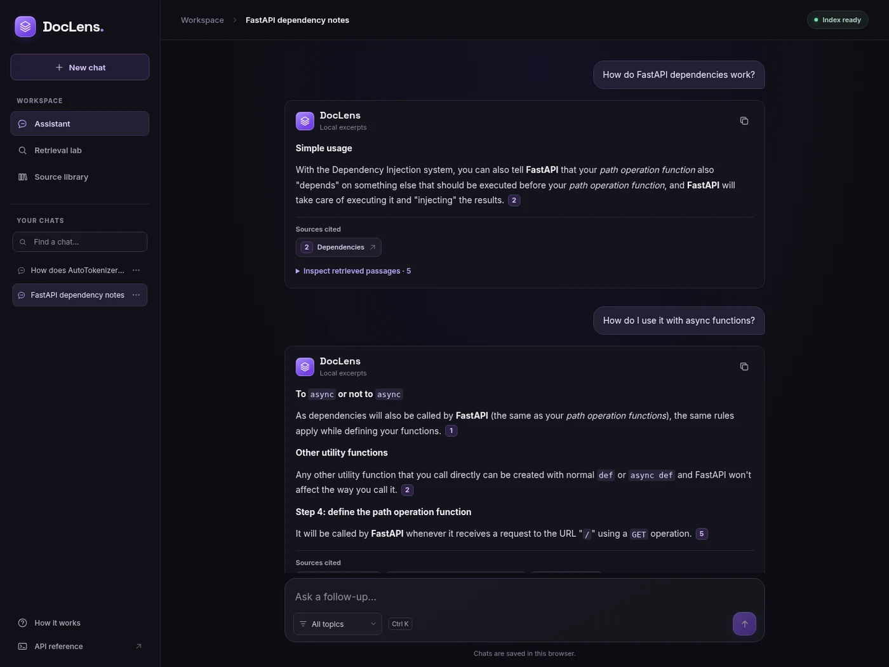
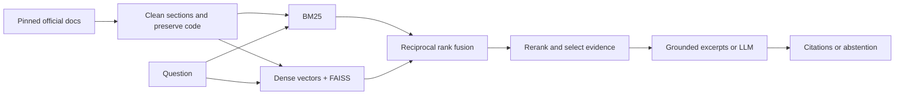

# DocLens

DocLens is a documentation-grounded AI engineering assistant for Python, FastAPI, Transformers, and retrieval-augmented generation. It searches **39 pinned official documentation pages** and links citations to the exact source lines.



The web app has three views.

- **Assistant** returns cited excerpts or a model-generated answer when configured. It abstains when its evidence is insufficient.
- **Retrieval lab** compares BM25, dense search, reciprocal rank fusion, and reranking. Expand a passage to see its text, raw score, and source.
- **Source library** browses the frozen documentation by topic, version, and license.

## Run locally

Use Python 3.12 and [uv](https://docs.astral.sh/uv/getting-started/installation/). The dependency lock was validated with uv 0.13.6.

```sh
uv sync --frozen
uv run --frozen python -m doclens verify
uv run --frozen uvicorn doclens.api:app --reload
```

Open [the workspace](http://127.0.0.1:8000) and [the OpenAPI reference](http://127.0.0.1:8000/docs). Give Uvicorn `--host 0.0.0.0` when running in a container. FastAPI serves both the API and the frontend. The default install needs no Node build, network requests at runtime, model weights, or API key. The interface and the indexed documentation are in English.

## How a question becomes an answer



1. The indexer parses Markdown, MDX, and reStructuredText. Heading-aware chunks target roughly 360 lexical pieces and retain stable IDs, heading paths, and original line numbers. FastAPI examples referenced by the selected pages are copied from the same Git revision.
2. BM25 preserves technical identifiers. The local dense baseline projects TF-IDF features into a 128-dimensional latent semantic space and uses cosine similarity via FAISS. Both methods can run independently or combine through RRF with `k=60`.
3. The default reranker uses token, phrase, heading, and prose coverage. It also spreads passages across explicitly named topics on cross-topic questions. Its raw scores have their own scale and should be read within a search method.
4. A lexical evidence gate can abstain before generation. The default answer quotes selected source passages. A configured LLM receives numbered evidence, and DocLens validates citation IDs before returning its output. Citation validation checks attribution and cannot by itself establish factual entailment.

## Optional model backends

Copy `.env.example` to `.env`, edit the relevant settings, and pass `--env-file .env` to `uv run` before the command.

| Setting | Purpose |
| --- | --- |
| `DOCLENS_PROVIDER` | `extractive` by default. Set `ollama` or `openai` for model generation. |
| `DOCLENS_MODEL` | Set the model tag or ID. Defaults to `qwen2.5:3b` for Ollama and `gpt-4o-mini` for OpenAI. |
| `DOCLENS_LLM_BASE_URL` | Ollama server or OpenAI-compatible base endpoint, including `/v1` where applicable. |
| `DOCLENS_LLM_API_KEY` | API key for a hosted backend. `OPENAI_API_KEY` is also supported. |
| `DOCLENS_EMBEDDINGS` | `lsa` by default. Set `sentence-transformers` to use a neural encoder. |
| `DOCLENS_EMBEDDING_MODEL` / `DOCLENS_EMBEDDING_REVISION` | Encoder ID or local directory, and optional revision. The default MiniLM snapshot is pinned in the settings. |
| `DOCLENS_RERANK_MODEL` / `DOCLENS_RERANK_REVISION` | Optional single-score cross-encoder ID or local directory and revision. |
| `DOCLENS_LOCAL_MODELS_ONLY` | Set to `1` to load models from local paths or caches. |

For Ollama, run your Ollama server and pull the configured model with `ollama pull qwen2.5:3b`. For a hosted endpoint, configure the appropriate model ID and key through the environment. The configured model receives the question and retrieved documentation.

For neural retrieval, install the extra first. Use either a model cache or an environment that can reach Hugging Face.

```sh
uv sync --frozen --extra semantic
DOCLENS_EMBEDDINGS=sentence-transformers \
  uv run --frozen --extra semantic python -m doclens search 'FastAPI request validation' --mode dense
```

When a generation backend fails to return a usable cited answer, the API reports the fallback and returns local excerpts if available. The project validates provider request and response contracts with test doubles. See the [evaluation report](reports/evaluation.md) for the measured baseline and model-access limits.

## API

| Endpoint | Result |
| --- | --- |
| `GET /health` | Loaded corpus metrics, active embedding backend, and generation mode. |
| `GET /sources` | Collections and documents with licenses and pinned revisions. |
| `POST /search` | Ranked passages and elapsed time. |
| `POST /ask` | Answer, citations, retrieved evidence, and abstention status. |

```sh
curl -sS http://127.0.0.1:8000/ask \
  -H 'Content-Type: application/json' \
  -d '{"question":"How do FastAPI dependencies work?","top_k":5}'
```

Both POST endpoints accept `mode` ( `bm25`, `dense`, `hybrid`, or `reranked` ), `top_k` from 1 to 12, and optional `topic`, `collection`, or `version` filters.

## Rebuild the corpus, run tests, and evaluate

```sh
uv run --frozen python -m doclens fetch
uv run --frozen python -m doclens index
uv run --frozen python -m unittest discover -s tests -v
uv run --frozen python -m doclens evaluate --output .cache/heading-evaluation.json
uv run --frozen python -m doclens evaluate --strategy recursive --skip-answers \
  --output .cache/recursive-evaluation.json
```

The checked-in [manifest](corpus/manifest.json) records exact upstream Git revisions, source URLs, retrieval date, licenses, and SHA-256 digests. `fetch` restores missing snapshots and verifies their bytes. `index` writes passage JSONL and a FAISS vector index to `.cache/index`. The server builds its live index from the same snapshots on startup.

The [benchmark](corpus/evaluation.json) includes 60 questions, reference answers, passage anchors, and reasons for out-of-scope cases. The [evaluation report](reports/evaluation.md) explains the results, and the [demo outline](reports/demo.md) gives a 15-minute walkthrough.

The upstream documentation and included FastAPI examples retain their notices and terms. See the [snapshot licenses](corpus/licenses). Inter and Space Grotesk were sourced from Fontsource 5.3.0 and retain their [Inter](doclens/web/assets/inter-OFL.txt) and [Space Grotesk](doclens/web/assets/space-grotesk-OFL.txt) OFL notices.
